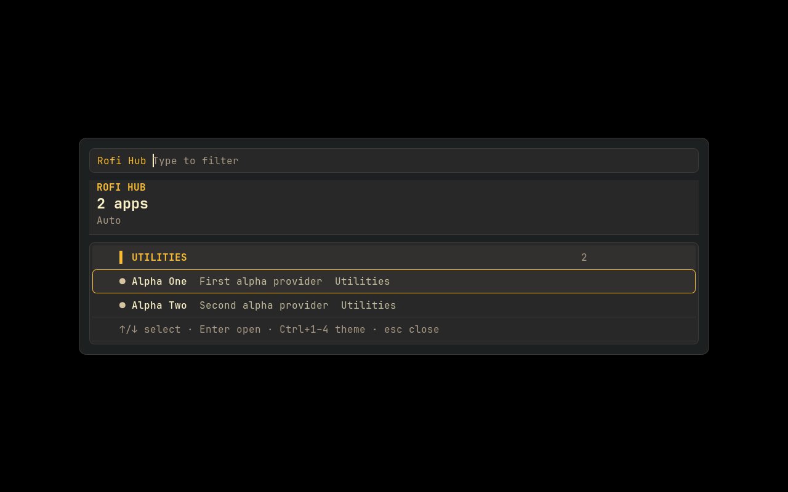
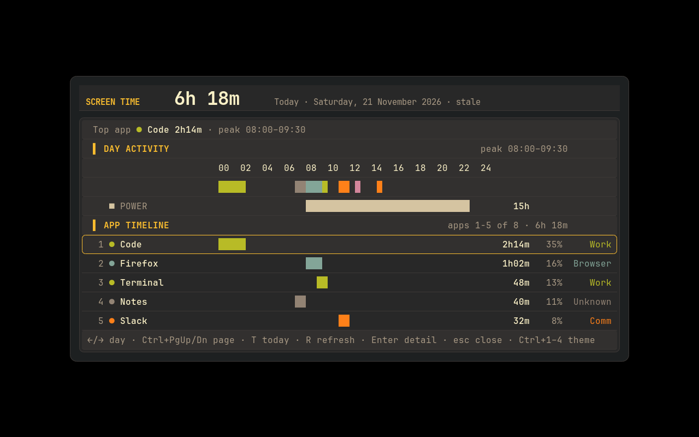
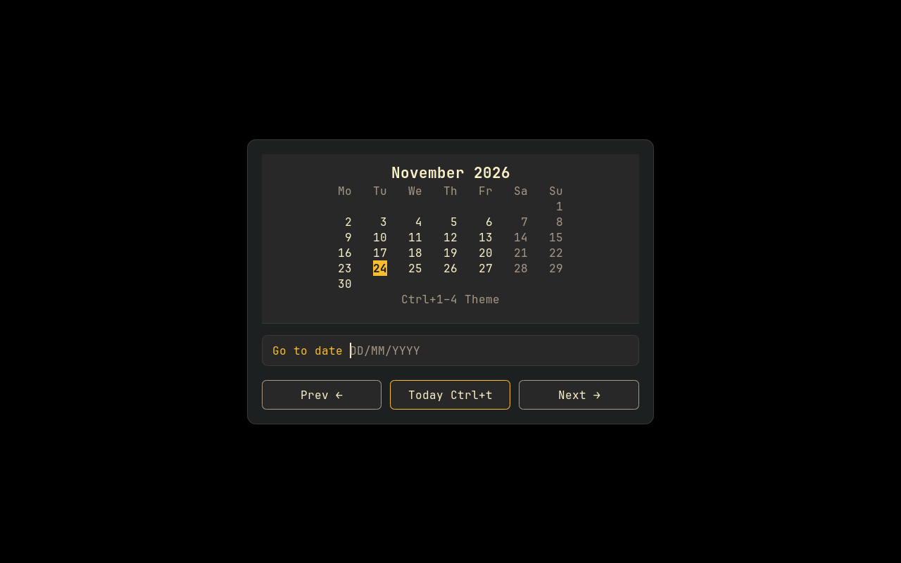
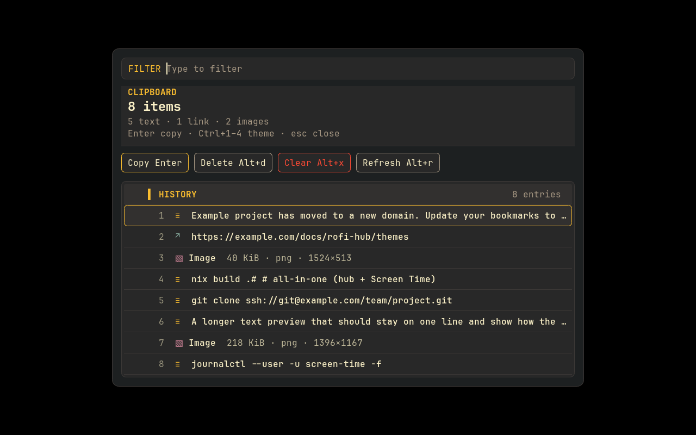
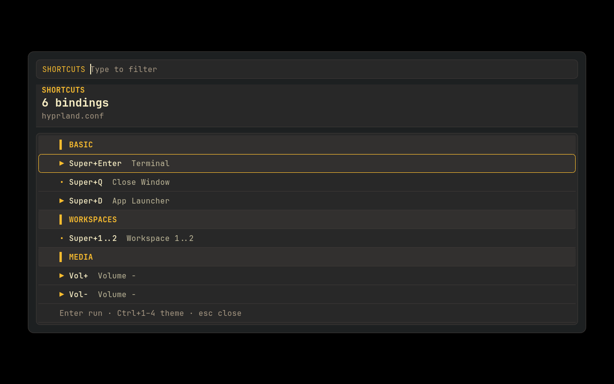
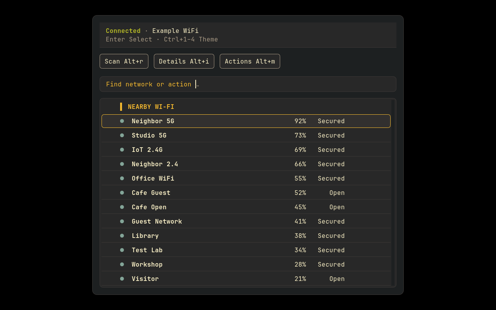
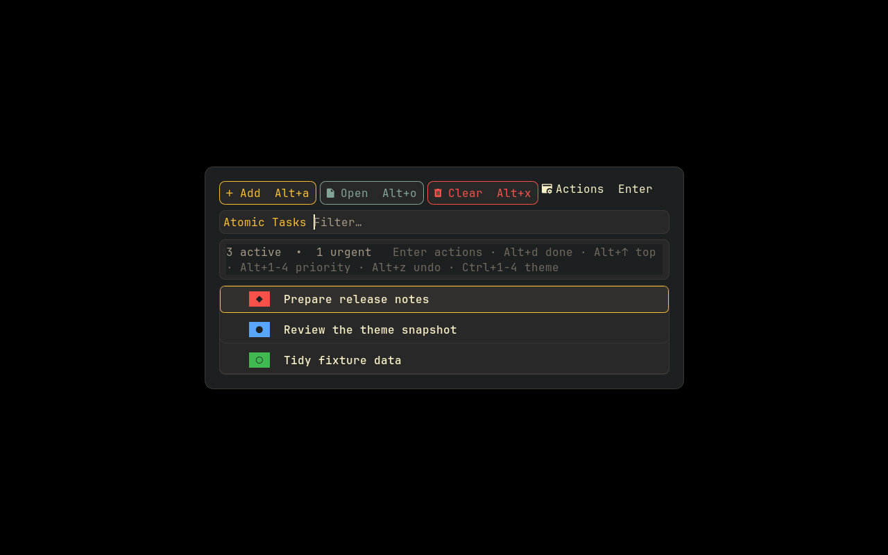

# rofi-apps

Independent Rofi apps and an optional launcher menu. Every app has its own
binary, provider manifest, release, version, and runtime dependencies. The
hub is no longer a runtime dependency: it only installs and manages app
packages.

### Ported app status

All seven apps are ported and independently runnable. Only the optional menu
can be removed without affecting the others; every app owns its own theme,
state, runtime tools, and release artifact.

| App | Status | Version | Launch | Runtime tools |
|---|---|---|---|---|
| Calendar | Ported | 1.2.0 | `rofi-calendar` | Rofi |
| Clipboard | Ported | 0.8.0 | `rofi-clipboard` | Rofi, `cliphist`, `wl-copy` |
| Keybinds | Ported | 1.0.0 | `rofi-keybinds` | Rofi |
| Network | Ported | 0.3.0 | `rofi-network` | Rofi, NetworkManager (`nmcli`) |
| Atomic Tasks | Ported | 0.1.0 | `atomic-note` | Rofi, Bash, jq, awk, flock |
| Screen Time | Ported · service | 0.5.0 | `rofi-screen-time` | Rofi; owns its user service |
| Hub menu | Optional | 0.3.0 | `rofi-hub-menu` | Rofi, provider manifests |

Every app supports the same `Ctrl+1–4` theme control (`Nord`, `Solarized
Light`, `Gruvbox Dark`, `Auto`) and keeps its own theme lock. Calendar,
Clipboard, Keybinds, Network, Atomic Tasks, and Screen Time continue from the
current filter and selection after a theme change.

`rofi-dmenu` is the shared library (`0.3.0`) used by the Rust apps. It contains
the dmenu protocol, theme resolution, paths, and UI helpers. No app depends on
the optional menu or the installer.

> **Project status:** `screen-time-rofi` is retired and archived. This
> repository is the canonical home for Screen Time and the Rofi apps. See
> [migrating an existing install](docs/MIGRATING.md).

## UI

### Snapshot

Every native app uses the same design language: zoned cards, 1px borders, a
shared palette, and an accent strip on the active row. The snapshots below are
real Rofi captures at 1280×800 from disposable fixtures: no real SSIDs, IP
addresses, clipboard contents, task text, command output, hostnames, or user
paths are shown.

| Menu | Screen Time | Calendar |
|---|---|---|
|  |  |  |

| Clipboard | Keybinds | Network |
|---|---|---|
|  |  |  |

| Atomic Tasks |
|---|
|  |

The full four-palette matrix and the interaction captures are in
[`docs/screenshots/ui`](docs/screenshots/ui/). See the
[full screenshot matrix](docs/screenshots/ui/README.md) and the
[UI style guide](docs/UI_STYLE.md).

### UI behavior

- **Keybinds.** Search matches both the shortcut and its description; the
  list uses 3 columns × 10 rows maximum; section bands never run a command.
- **Clipboard.** Copy, Delete, Clear, and Refresh are real RASI buttons and
  share the keyboard paths (`Enter`, `Alt+d`, `Alt+x`, `Alt+r`).
- **Hub Menu.** `Ctrl+1–4` keeps the typed filter, selected provider, and
  window height; `Ctrl+4` restores the configured theme.
- **Theme.** Calendar, Clipboard, Keybinds, Network, Atomic Tasks, and Screen
  Time all use `Ctrl+1–4` for Nord, Solarized Light, Gruvbox Dark, and Auto.
  The chosen palette is app-owned in
  `~/.local/state/rofi-apps/<app>/theme-choice`; `Ctrl+4` clears the lock and
  returns to the configured theme. The hub menu keeps its own state.
- **Screen Time.** The row under the cursor is separate from the expanded
  detail and is restored by app name, page, and date after a theme change.
- **Atomic Tasks.** `Enter` or the `Actions` button expands Done, Edit, Move,
  and priorities on the task list; no second task menu is used. `Ctrl+1–4`
  switches the palette without losing the filter or expanded state.
- **Calendar.** Prev/Today/Next are RASI buttons outside the filterable list,
  so they remain visible while a partial date is typed.
- **Network.** The main view shows 12 nearby Wi-Fi candidates and keeps
  Details/Alt+i on the same screen.


## Install

Only two channels are supported:

1. **Nix** — flake packages and modules (primary).
2. **`install.sh`** — signed per-app release (secondary, non-Nix distros).

No `.deb`, `.rpm`, `.apk`, AUR, distro recipe, or source asset is published.

### NixOS

Add the flake input:

```nix
inputs.rofi-apps.url = "github:WillGle/rofi-hub";
```

Import the umbrella module and enable only the apps you want:

```nix
imports = [ inputs.rofi-apps.nixosModules.default ];

services.rofi-apps.calendar.enable = true;
services.rofi-apps.clipboard.enable = true;
services.rofi-apps.screen-time.enable = true;
services.rofi-apps.menu.enable = false; # optional
```

Each option installs only that app package and the app's own dependencies.
Atomic Tasks can be enabled independently with `services.rofi-apps.atomic-note.enable = true;`
or installed with `bash install.sh --app atomic-note`. Run `atomic-note` to open it.
It uses the existing `~/.atomic_tasks` and `~/.atomic_tasks.done` files, including
for users migrating from the older Home Manager script. The `render-waybar`
subcommand remains available for an optional Waybar integration.

`screen-time` owns its user service; the other apps do not install services.
The old `services.rofi-hub.enable` option is kept as a deprecated alias that
maps the selected apps to `services.rofi-apps.<app>.enable`.

Individual modules are available as `nixosModules.rofi-calendar`,
`nixosModules.rofi-clipboard`, `nixosModules.rofi-keybinds`,
`nixosModules.rofi-network`, `nixosModules.atomic-note`, `nixosModules.screen-time`, and
`nixosModules.rofi-hub-menu`.

### Home Manager

```nix
{
  imports = [ inputs.rofi-apps.homeManagerModules.default ];

  services.rofi-apps.calendar.enable = true;
  services.rofi-apps.screen-time.enable = true;
}
```

The equivalent module names are under `homeManagerModules.*`. The deprecated
`homeManagerModules.rofi-hub` alias maps `services.rofi-hub.*` to the per-app
options and prints a warning.

### Nix profile

```bash
nix profile add github:WillGle/rofi-hub#rofi-calendar
nix profile add github:WillGle/rofi-hub#rofi-clipboard
nix profile add github:WillGle/rofi-hub#rofi-network
nix profile add github:WillGle/rofi-hub#atomic-note
nix profile add github:WillGle/rofi-hub#screen-time
nix profile add github:WillGle/rofi-hub#rofi-hub-menu   # optional
```

`nix build .#rofi-calendar` builds exactly one app; its closure does not
contain the menu, the installer, or another app.

### Other Linux distributions

Install the signed per-app release as your desktop user. Rofi must already be
installed; `install.sh` only checks prerequisites, it never installs them.

```bash
base=https://github.com/WillGle/rofi-hub/releases/latest/download
curl -fsSLO https://raw.githubusercontent.com/WillGle/rofi-hub/main/minisign.pub
curl -fsSLO "$base/install.sh" "$base/install.sh.minisig"
minisign -Vm install.sh -p minisign.pub   # key id F1A59235D536DB40
bash install.sh --app calendar
```

Commands:

```bash
bash install.sh --list                  # index + installed state
bash install.sh --app calendar          # one app
bash install.sh --app calendar,clipboard
bash install.sh --all                   # every non-optional app
bash install.sh --update calendar       # one app
bash install.sh --uninstall calendar    # one app
bash install.sh --app screen-time --no-service
```

State is per app under `~/.local/state/rofi-apps/installed/<id>`. Update or
uninstall one app without touching another. The installer refuses Nix-managed
paths, verifies checksums and minisign signatures by default, rejects path
traversal, and never writes themes, `ROFI_HUB_*` variables, or `PATH` wrappers.

## Use

Direct launch works without the menu:

```bash
rofi-calendar
rofi-clipboard
rofi-keybinds
rofi-network
atomic-note
rofi-screen-time
```

The optional menu reads provider manifests and execs apps with your normal
environment:

```bash
rofi-hub-menu list
rofi-hub-menu calendar
rofi-hub-menu --theme nord
```

Removing `rofi-hub-menu` never breaks an app.

### Theme

Theme ownership is split into three layers:

| Layer | Owner | File |
|---|---|---|
| Base theme | user / theme module | `~/.config/rofi/theme.rasi` or `ROFI_THEME` |
| App layout | app package | `$XDG_DATA_DIRS/rofi/<app>.rasi` |
| App override | user | `~/.config/rofi/<app>.rasi` |
| App theme lock | app | `~/.local/state/rofi-apps/<app>/theme-choice` |
| Menu theme | optional menu | `share/rofi/hub-menu.rasi` + `~/.config/rofi-hub-menu/theme` |

Resolution order for every app:

1. `~/.config/rofi/<app>.rasi`
2. `ROFI_THEME`
3. `~/.config/rofi/theme.rasi` + app layout
4. packaged `$XDG_DATA_DIRS/rofi/<app>.rasi`
5. built-in fallback

Every app may also have an app-owned theme lock from `Ctrl+1–4`; the lock
selects a palette over this resolved theme and `Ctrl+4` removes it. The lock
is stored per app and never changes another app's theme.

### Environment

| Variable | Effect |
|---|---|
| `ROFI_BIN` | Rofi executable used by the apps and the Screen Time wrapper. |
| `ROFI_CONFIG` | Rofi config passed with `-config`. |
| `ROFI_THEME` | Full global theme override. |
| `ROFI_APPS_INDEX` | Default release index for `install.sh`. |
| `ROFI_APPS_PREFIX` | Default install prefix for `install.sh`. |
| `ROFI_APPS_PUBKEY` | minisign public key for `install.sh`. |

`ROFI_HUB_THEME`, `ROFI_HUB_THEME_FILE`, `ROFI_HUB_PROVIDER`, and
`ROFI_HUB_PROVIDER_DIR` are removed from the app path.

### Menu configuration

Optional `~/.config/rofi-hub-menu/config.toml`:

```toml
[ui]
prompt = "Rofi Hub"

[theme]
mode = "gruvbox" # auto | nord | solarized | gruvbox | /path/to/theme.rasi

[launcher]
columns = 3
lines = 10
```

The launcher defaults to 3 columns × 10 rows; both values are clamped
(`columns` 1–6, `lines` 1–10). `rofi-hub-menu emoji` uses a fixed 4 × 15 grid,
and `rofi-hub-menu power` uses 3 columns × 2 rows.
The menu owns this state. Apps never read it. `Ctrl+1–4` inside the menu
writes a palette layer over the resolved theme, so the base font, layout, and
window geometry stay intact; `Ctrl+4` returns to the configured theme.

## Repository layout

```
crates/rofi-dmenu/       shared dmenu/theme/path/UI library
crates/rofi-calendar/    app.toml, provider, layout, source
crates/rofi-clipboard/
crates/rofi-keybinds/
crates/rofi-network/
crates/atomic-note/     task queue shell app, provider, layout, tests
crates/screen-time/      tracker, Rofi UI, and its user service
crates/rofi-hub-menu/    optional provider menu
installer/               release index schema
modules/nixos/           per-app NixOS modules
modules/home-manager/    per-app Home Manager modules
install.sh               signed per-app installer
uninstall.sh             thin uninstall wrapper
flake.nix                packages and modules
scripts/                 release, test, and dependency guards
```

## Development

```bash
nix develop
cargo fmt --check --all
cargo clippy --workspace --all-targets -- -D warnings
cargo test --workspace --locked
python3 scripts/check-deps.py
python3 scripts/check-app-sync.py
scripts/test-apps.sh
scripts/test-theme.sh
bash crates/atomic-note/tests/menu.sh
scripts/test-installer.sh
scripts/package-release.sh
scripts/test-bundle.sh dist
scripts/test-release-index.sh dist
scripts/test-migration.sh
nix flake check
```

`check-deps.py` enforces the one-way dependency graph: apps may depend on
`rofi-dmenu`, never on the menu or installer. `test-apps.sh` and
`test-theme.sh` run apps against a fake Rofi in a temporary XDG environment.
`crates/atomic-note/tests/menu.sh` covers the inline task action area with a
fake Rofi and disposable HOME.
`test-installer.sh` covers installation, update/uninstall independence,
missing prerequisites, bad checksums, unsigned releases, path traversal,
permissions, rollback, services, and the optional menu. `test-nix.sh` verifies
per-app closures and module ownership.

## License

MIT. See [LICENSE](LICENSE).
