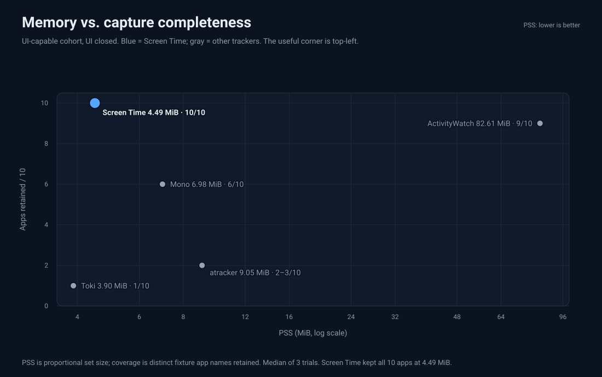
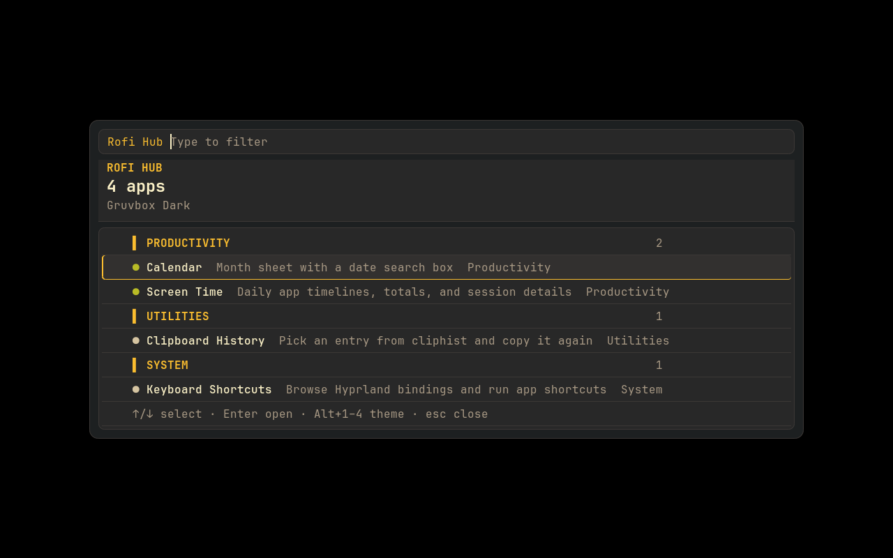
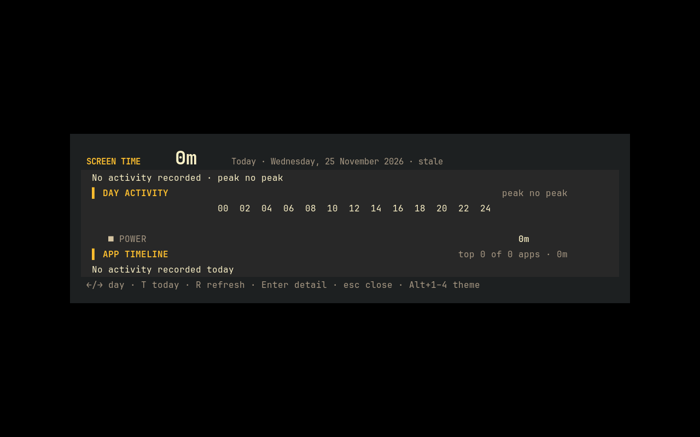
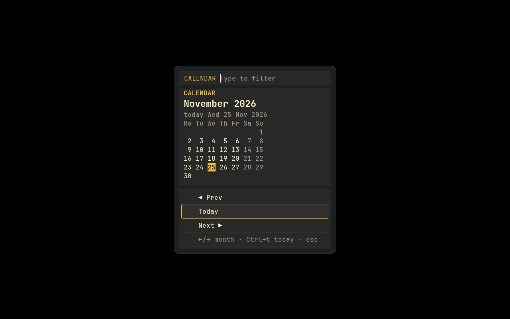
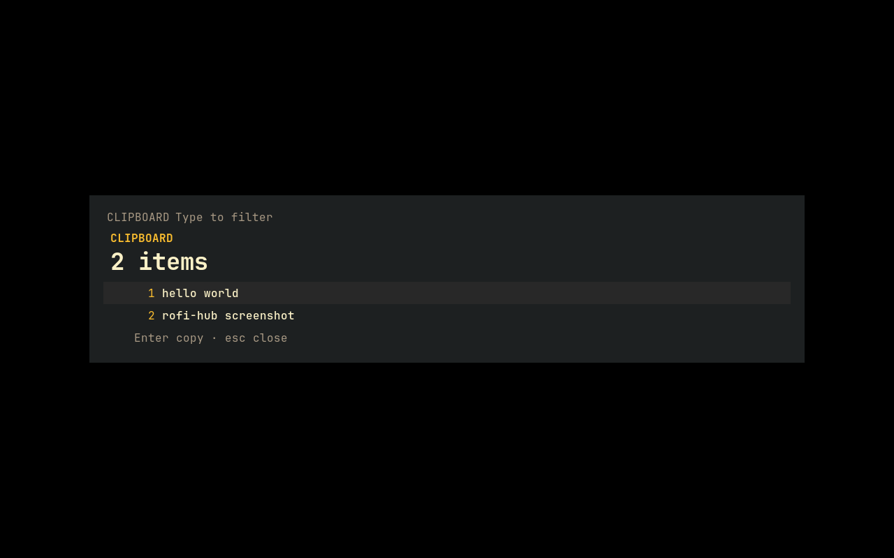
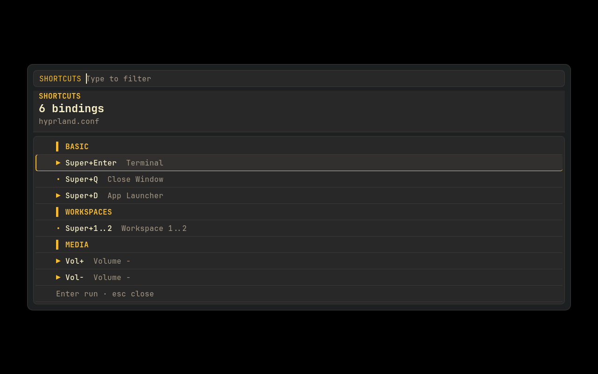

# rofi-hub

A small Rust workspace for Rofi desktop tools. The `rofi-hub` launcher shows
installed sub-apps in one keyboard-driven menu, remembers your theme, and
starts the selected app. The bundle ships **Screen Time** (a local Hyprland
tracker), **Calendar**, **Keyboard Shortcuts**, and **Clipboard History**.

One signed bundle contains the hub and every app. The installer can install the
all-in-one hub, only selected apps, or only the launcher.

> **Project status:** `screen-time-rofi` is retired and archived. This
> repository is the canonical home for Screen Time and future Rofi apps. See
> [migrating an existing install](docs/MIGRATING.md).

[](crates/screen-time/docs/EVALUATION.md)

[](https://repology.org/project/rofi-hub/versions)

## UI

Every native app shares one Gruvbox Dark design language: the same palette,
header/section/row grammar, selection strip, and footer hints. The screenshots
below are real Rofi captures (not mockups).

| Hub | Screen Time | Calendar |
|---|---|---|
|  |  |  |

| Clipboard | Keybinds | Network |
|---|---|---|
|  |  |  |

[Full 6 app × 4 mode screenshot matrix](docs/screenshots/ui/README.md) ·
[UI style guide](docs/UI_STYLE.md) · `rofi-hub theme dump --app <app>`

## Install

**Nix is the primary installation path.** It is self-contained: hub, apps,
Screen Time, providers, themes, and the user service. No local checkout or
`install.sh` is required.

### NixOS server (recommended)

Add the flake input to `/etc/nixos/flake.nix`:

```nix
inputs.rofi-hub.url = "github:WillGle/rofi-hub";
outputs = { nixpkgs, home-manager, rofi-hub, ... }@inputs: # add rofi-hub
```

Import the standalone NixOS module and enable it:

```nix
imports = [ inputs.rofi-hub.nixosModules.default ];

services.rofi-hub.enable = true;
```

Rebuild:

```bash
sudo nixos-rebuild switch --flake /etc/nixos#<host>
rofi-hub --version
rofi-hub list --json
systemctl --user status screen-time
```

No Home Manager is required. The module installs the all-in-one package and the
`screen-time` user service.

### Nix profile (other Nix machines)

```bash
nix profile add github:WillGle/rofi-hub
rofi-hub --version
```

Or run without installing:

```bash
nix run github:WillGle/rofi-hub -- --version
```

### Home Manager

```nix
{
  inputs.rofi-hub.url = "github:WillGle/rofi-hub";
  imports = [ inputs.rofi-hub.homeManagerModules.default ];

  services.rofi-hub = {
    enable = true;
    apps = [ "screen-time" "calendar" "keybinds" "clipboard" ];
  };
}
```

`apps = []` installs only the hub; `apps = [ "screen-time" ]` installs the hub
and tracker.

### Other Linux distributions (secondary: `install.sh`)

On a non-Nix distro with Hyprland, Rofi 2.x, minisign, and a systemd user
session, install the signed bundle as your desktop user:

```bash
base=https://github.com/WillGle/rofi-hub/releases/latest/download
curl -fsSLO https://raw.githubusercontent.com/WillGle/rofi-hub/main/minisign.pub
curl -fsSLO "$base/install.sh" "$base/install.sh.minisig"
minisign -Vm install.sh -p minisign.pub   # key id F1A59235D536DB40
bash install.sh
~/.local/bin/rofi-hub
```

`install.sh` installs the hub and every app by default. Select components with
`--app screen-time`, `--app calendar,keybinds,clipboard`, or `--list-apps`.

Updates are signed and opt-in:

```bash
bash install.sh --check
bash install.sh --update
bash install.sh --rollback
bash uninstall.sh
```

## Packaging

**Nix is the primary product path**: flake package, standalone NixOS module, and
Home Manager module. **`install.sh` is the secondary path** for non-Nix distros.
The Debian `.deb` and Fedora `.rpm` are additional release artifacts, not the
primary installation method.

- **Nix** — flake, `nixosModules.default`, `homeManagerModules.default`.
- **`install.sh`** — signed release tarball, user-local install/update/rollback.
- **Additional artifacts** — Debian/Ubuntu `.deb`, Fedora `.rpm`.
- **Experimental** — Arch/AUR, Alpine `.apk`, openSUSE, Gentoo, Void,
  Slackware, ALT, and the extra source asset.

| Target | Version | Status |
|---|---|---|
| Nix flake / NixOS / Home Manager | 0.2.1 | ✅ primary |
| `install.sh` tarball (non-Nix) | 0.2.1 | ✅ secondary |
| Debian/Ubuntu `.deb` | 0.2.1 | ➕ additional artifact |
| Fedora `.rpm` / spec | 0.2.1 | ➕ additional artifact |
| nixpkgs | — | ⏸ deferred |
| Debian official source package | 0.2.1 | 🧪 experimental; sponsorship pending |
| Arch/AUR | 0.2.1 | 🧪 experimental recipe; not published |
| Alpine `.apk` | 0.2.1 | 🧪 experimental artifact |
| openSUSE / Gentoo / Void / SlackBuilds / ALT | 0.2.1 | 🧪 experimental recipes |

See [packaging](docs/PACKAGING.md) for the dependency matrix, install layout,
service files, and per-distro commands.

## Use

Every native app shares one design language: Gruvbox Dark by default, 20px
window padding, the same palette roles, and a 2px accent strip on the active
row. Direct launches generate the same profile-aware theme, so the look stays
consistent without starting the hub first. See [UI style](docs/UI_STYLE.md).

### Hub

- `↑` / `↓` selects an app, `Enter` opens it, and `Esc` closes the menu.
- Type to filter.
- `Alt+1` Nord, `Alt+2` Solarized Light, `Alt+3` Gruvbox Dark, `Alt+4` Auto.
  The choice is saved under `~/.config/rofi-hub/theme`.
- `rofi-hub --theme nord` overrides the theme for one run.
- `rofi-hub theme list`, `rofi-hub theme set nord`, and `rofi-hub theme show`
  manage the saved theme from a terminal.
- `rofi-hub theme dump --app hub` (or `screen-time`, `calendar`, `clipboard`,
  `keybinds`, `network`) prints the generated `.rasi` for that profile.
- `rofi-hub screen-time` opens one app directly.

The old `rofi app manager` command surface is kept as aliases in
`rofi-hub`:

```bash
rofi-hub launcher    # rofi -show drun
rofi-hub window      # rofi -show window
rofi-hub calc        # rofi-calc plugin
rofi-hub emoji       # rofi-emoji plugin
rofi-hub power       # rofi-power-menu
rofi-hub calendar    # Calendar provider
rofi-hub clipboard   # Clipboard provider
rofi-hub keybinds    # Keyboard Shortcuts provider
rofi-hub show drun   # raw Rofi mode with the shared theme
```

`rofi-hub network` opens a NetworkManager menu. It shows the active connection
panel (SSID, signal, band, IP, gateway, subnet, broadcast, DNS, MAC, security),
quick actions, nearby Wi-Fi networks, wired interfaces, saved profiles, edit
saved connection, rescan, and radio toggle. It requires `nmcli`.

### Calendar

- Enter on the sheet opens today; type `15`, `15/3`, `3/2027`,
  `15/3/2027`, or `2027-03-15` to jump.
- `←` / `→` browse months and `Ctrl+t` returns to today.

### Keyboard Shortcuts

- Sections come from `# --- Name ---` comments in `hyprland.conf`.
- `Enter` runs a shortcut whose dispatcher is `exec`; other rows are
  reference only.

### Clipboard History

- Lists `cliphist` entries; `Enter` copies the selected entry with `wl-copy`.

### Screen Time

- `←` / `→` browse days, `T` returns to today, and `R` refreshes.
- `↑` / `↓` selects an app, `Enter` opens its details, and `Backspace` returns.
- `Alt+1` through `Alt+3` select Nord, Solarized Light, or Gruvbox Dark;
  `Alt+4` clears the saved choice and restores the configured theme.

See the [Screen Time user guide](crates/screen-time/docs/USER_GUIDE.md) for
distro dependencies, configuration, retention, and troubleshooting.

## Privacy and data

Screen Time stores app-level history only. Window titles are parsed just far
enough to find the event separator and are never persisted or rendered. Idle
and suspend gaps are excluded. The database lives at
`~/.local/state/screen-time/screen-time.db`; updates and backups live at
`~/.local/state/rofi-hub/`.

## Repository layout

```
crates/rofi-core/       provider manifests, Rofi dmenu, themes, paths
crates/rofi-hub/        the hub launcher
crates/rofi-calendar/   month sheet with date search
crates/rofi-keybinds/   Hyprland shortcut reference
crates/rofi-clipboard/  cliphist picker
crates/screen-time/     the Screen Time tracker and its Rofi UI
providers/              provider manifests shipped in the bundle
themes/                 fallback hub theme
install.sh              signed bundle installer/updater
flake.nix               packages and the Home Manager module
```

## Environment

| Variable | Effect |
| --- | --- |
| `ROFI_BIN` | Rofi executable used by the hub and the Screen Time wrapper. |
| `ROFI_CONFIG` | Extra Rofi config passed with `-config`; both UIs honor it. |
| `ROFI_THEME` | Base theme used by the hub's `auto` mode and the Screen Time fallback. |
| `ROFI_HUB_THEME` | One-run theme override; does not change the saved choice. |
| `ROFI_HUB_PROVIDER_DIR` | Extra provider directories, colon-separated. |
| `ROFI_HUB_PROVIDER`, `ROFI_HUB_THEME`, `ROFI_HUB_THEME_FILE` | Set for the launched provider. |

Providers are resolved from `PATH`, then from the directory containing the
`rofi-hub` binary, so a `~/.local/bin` install works even when the graphical
session does not include that directory in `PATH`. The hub never kills other
Rofi processes; each app owns its PID file.

`rofi-hub list --json` is the stable registry for desktop integrations
(Hyprland, Waybar, keybind menus): read ids, names, commands, and availability
from it instead of hardcoding labels.

See [architecture](docs/ARCHITECTURE.md) for the provider contract and update
model, and [migration notes](docs/MIGRATING.md) if you used the retired
`screen-time-rofi` repository.

## Development

```bash
nix develop
python3 scripts/check-app-sync.py
cargo fmt --check --all
cargo clippy --workspace --all-targets -- -D warnings
cargo test --workspace --locked
shellcheck install.sh uninstall.sh scripts/*.sh
scripts/test-installer.sh
scripts/package-release.sh
scripts/test-bundle.sh dist/rofi-hub-$(uname -m)-linux.tar.gz
nix flake check
nix build .#
```

`check-app-sync.py` treats `providers/*.toml` as the canonical app list and
fails when the workspace, installer, Nix outputs, release package, or installer
fixture drift. `test-bundle.sh` unpacks a release bundle, runs
`rofi-hub list --json`, and checks every provider binary, version, and Screen
Time support file. The app crates also have integration tests with a fake Rofi
(`crates/*/tests/cli.rs`).

The CI pipeline runs lint, workspace tests, the MSRV (Rust 1.89), installer
fault injection, the install tree on x86_64 and aarch64, bundle smoke tests,
the five-distro build matrix, and Nix flake checks. Tag builds build the
`.deb`, `.rpm`, `.apk`, and source assets, smoke-test them in clean containers,
then sign `SHA256SUMS` and upload the complete set to the GitHub release.

## License

MIT. See [LICENSE](LICENSE).
