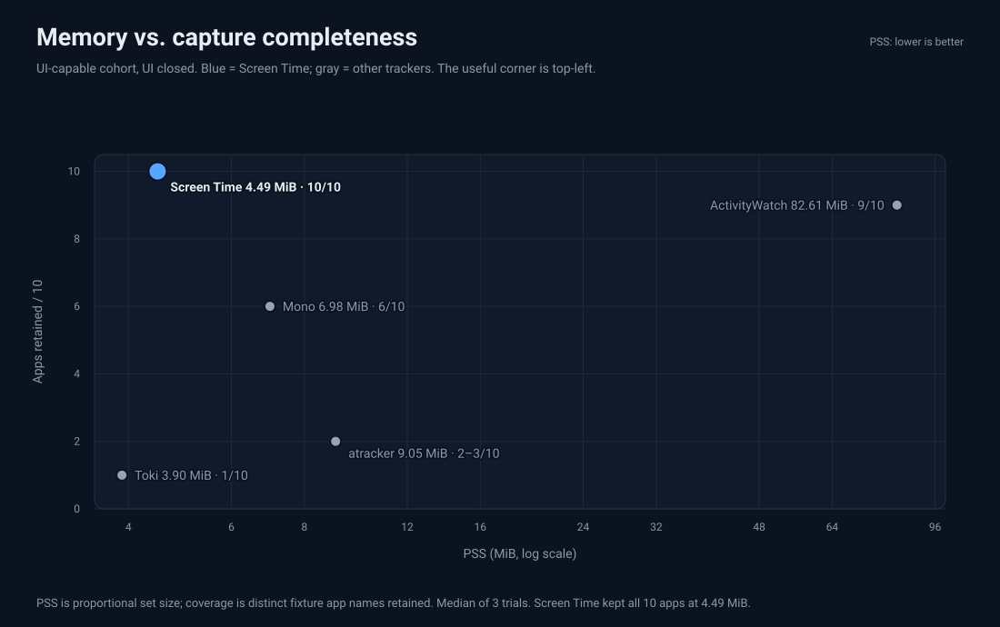

# Screen Time

A local screen-time tracker for Hyprland and systemd. Open Rofi to see daily
totals, app timelines by category, and session details. This crate is part of
the [rofi-hub](../../README.md) workspace; the hub installer can install it
alone or alongside the launcher.

[](docs/EVALUATION.md)

Screen Time stays in the low-memory group while keeping all 10 fast-switch
apps. [See the charts and full comparison →](docs/EVALUATION.md)

## Quick start

On Linux with Hyprland, Rofi 2.x, minisign, and a systemd user session,
download and verify the release installer as your desktop user:

```bash
base=https://github.com/WillGle/rofi-hub/releases/latest/download
curl -fsSLO https://raw.githubusercontent.com/WillGle/rofi-hub/main/minisign.pub
curl -fsSLO "$base/install.sh" "$base/install.sh.minisig"
minisign -Vm install.sh -p minisign.pub   # key id F1A59235D536DB40
less install.sh
bash install.sh --app screen-time
~/.local/bin/rofi-screen-time
```

Updates are opt-in: `bash install.sh --check` only reports, and
`--auto-update=check` or `--auto-update=apply` install signed user timers. See
[data safety and updates](docs/AUTO_UPDATE.md).

On NixOS or standalone Home Manager, import
`inputs.rofi-hub.homeManagerModules.screen-time` and set
`services.screen-time.enable = true`. To preview an existing checkout:

```bash
nix build .#screen-time
./result/bin/rofi-screen-time
```

See the [user guide](docs/USER_GUIDE.md)
for distro dependencies, Nix and Home Manager examples, updates, and troubleshooting.
See the [evaluation](docs/EVALUATION.md)
for charts, sandbox benchmarks, and a comparison with UI-capable Linux trackers.

## Use

- `←` / `→` browse days, `T` returns to today, and `R` refreshes.
- `↑` / `↓` selects an app, `Enter` opens its details, and `Backspace` returns.
  `Esc` closes the popup.
- `Alt+1` through `Alt+3` select and remember Nord, Solarized Light, or Gruvbox Dark.
  `Alt+4` clears the saved choice and restores the configured theme.

To set a default theme, edit `~/.config/screen-time/config.toml` and reopen Rofi:

```toml
[theme]
mode = "nord" # auto | matugen | static | config | nord | solarized | gruvbox
```

The hub installer also ships `~/.local/share/screen-time/config.example.toml`.
Run `screen-time config init` to copy it into place without overwriting an
existing config.

[Developer docs](docs/README.md) · [MIT license](LICENSE)
