# UI screenshot matrix

Real Rofi captures of the six native apps in four theme modes, generated
headlessly with Xvfb, Arch's Rofi 2.x, and JetBrainsMono Nerd Font.

The README shows the Gruvbox row. Every app also has `nord`, `solarized`, and
`auto` captures in this directory.

| App | Gruvbox Dark | Nord | Solarized Light | Auto |
|---|---|---|---|---|
| Hub | [](hub-gruvbox.png) | [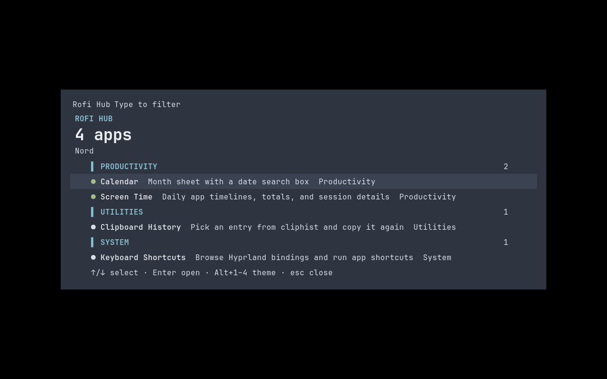](hub-nord.png) | [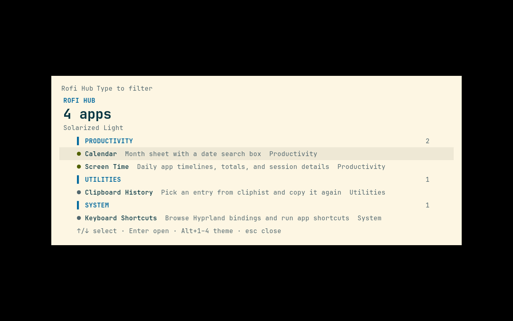](hub-solarized.png) | [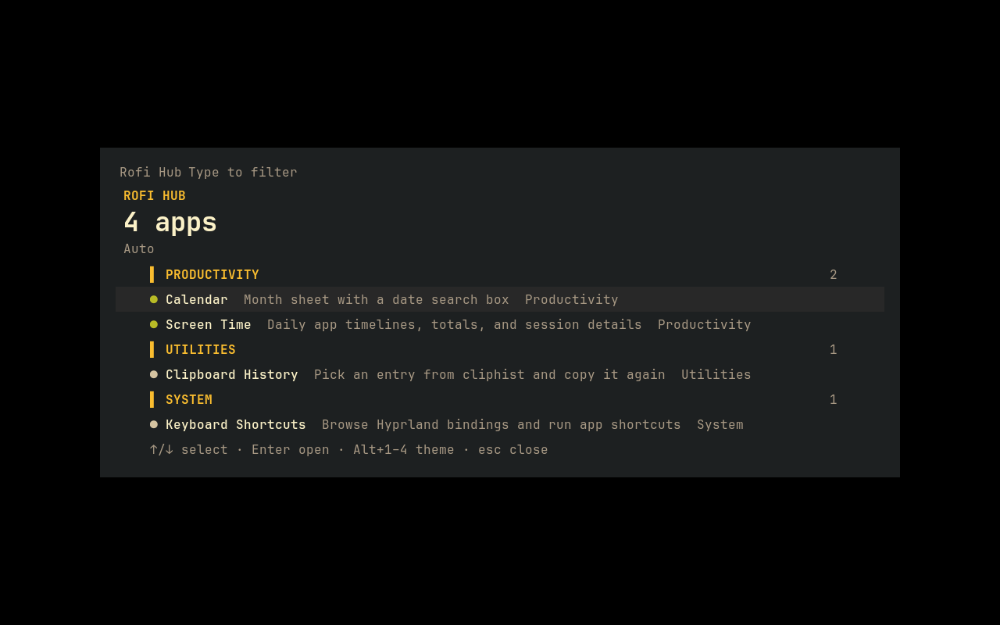](hub-auto.png) |
| Screen Time | [](screen-time-gruvbox.png) | [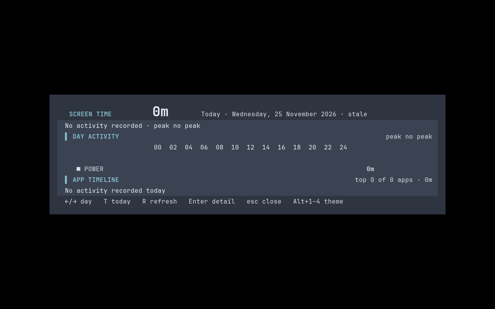](screen-time-nord.png) | [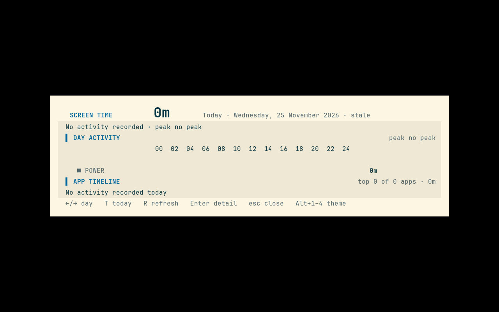](screen-time-solarized.png) | [](screen-time-auto.png) |
| Calendar | [](calendar-gruvbox.png) | [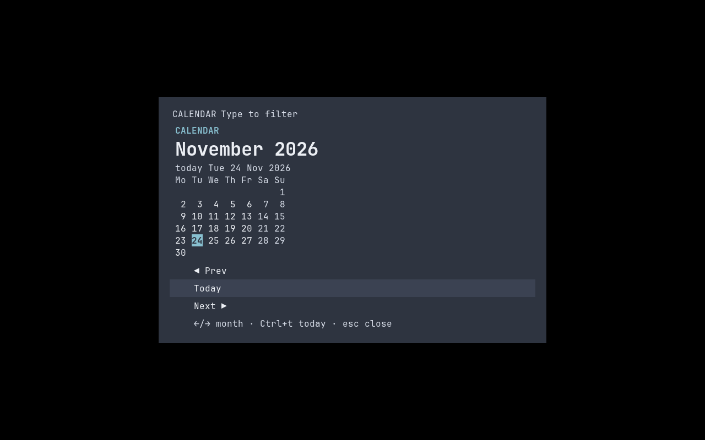](calendar-nord.png) | [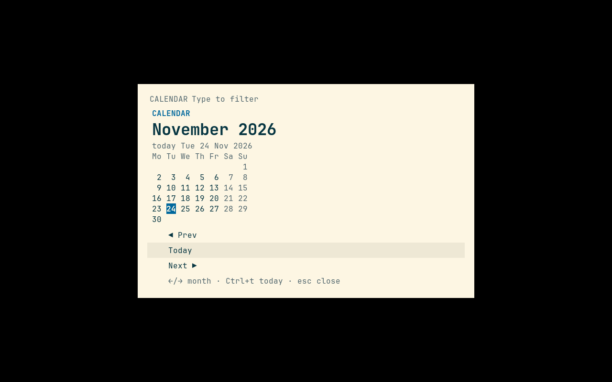](calendar-solarized.png) | [](calendar-auto.png) |
| Clipboard | [](clipboard-gruvbox.png) | [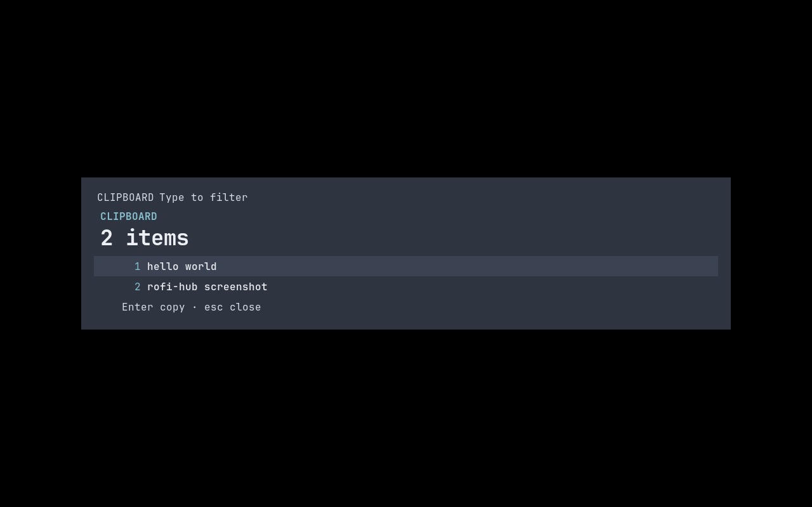](clipboard-nord.png) | [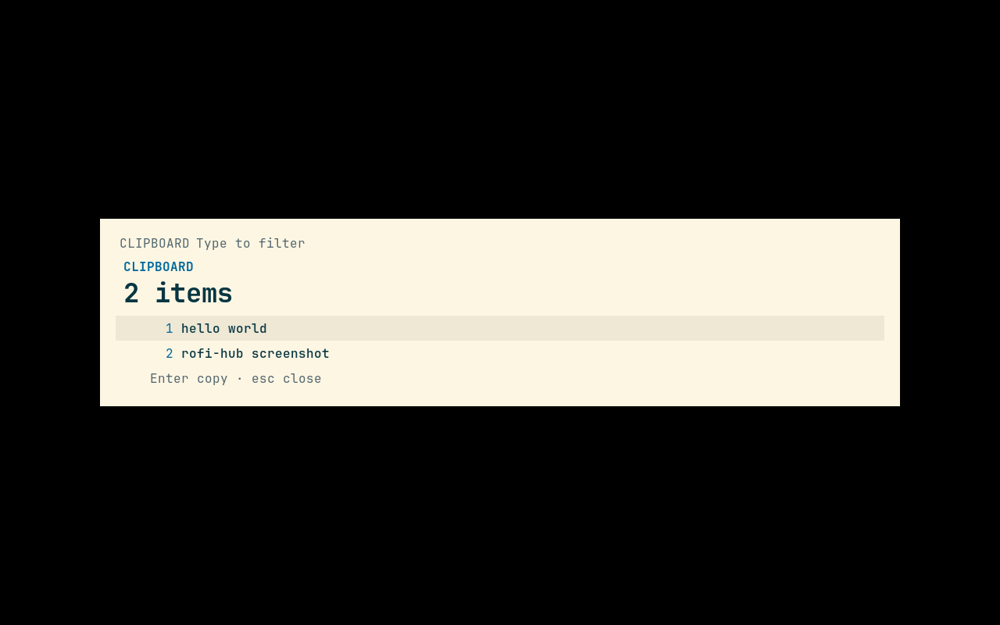](clipboard-solarized.png) | [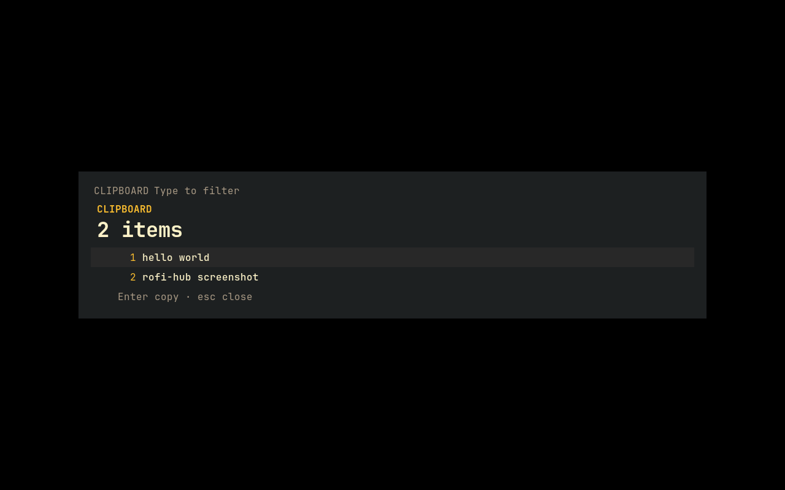](clipboard-auto.png) |
| Keybinds | [](keybinds-gruvbox.png) | [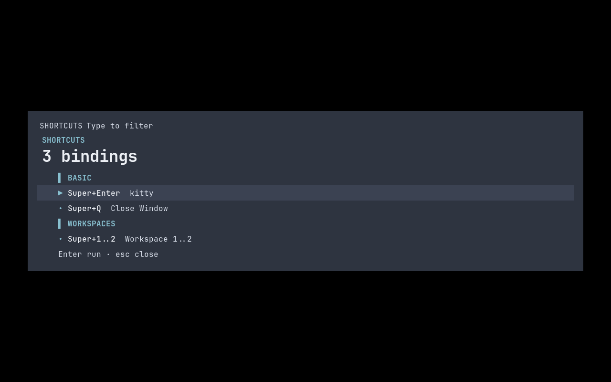](keybinds-nord.png) | [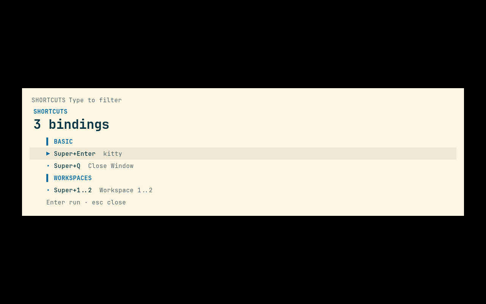](keybinds-solarized.png) | [](keybinds-auto.png) |
| Network | [](network-gruvbox.png) | [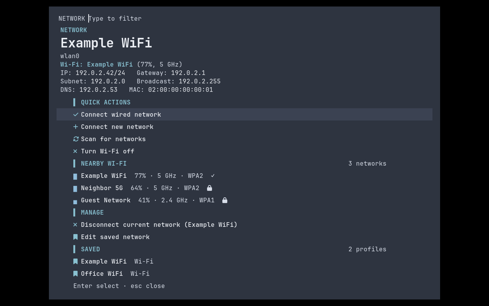](network-nord.png) | [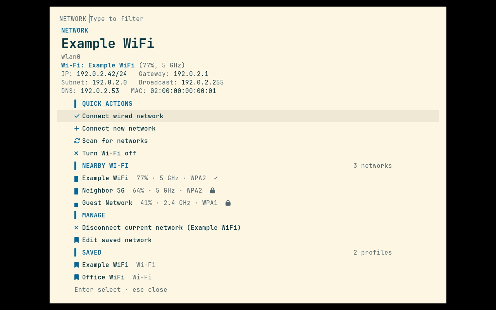](network-solarized.png) | [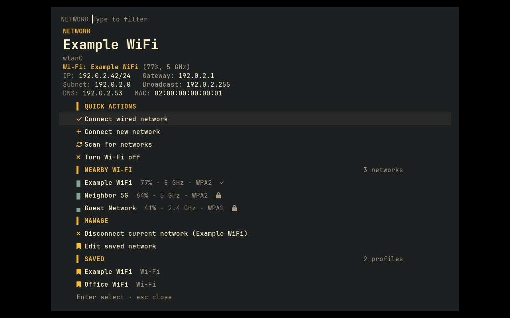](network-auto.png) |

The `auto` column falls back to Gruvbox when no matugen palette or
`static.env` is present. See [UI style](../../UI_STYLE.md) for the palette,
component grammar, and `ChromeProfile` table.

## Regenerating

The captures use the real app binaries through Rofi dmenu, not mockups. The
generation environment needs an X11-capable Rofi, `Xvfb`, and ImageMagick:

```bash
cargo build --release --locked --workspace
DESTDIR=/tmp/ui-stage PREFIX=/usr packaging/install-tree.sh --all
Xvfb :99 -screen 0 1280x800x24 &
DISPLAY=:99 HOME=/tmp/ui-home XDG_CONFIG_HOME=/tmp/ui-config \
  XDG_DATA_HOME=/tmp/ui-data XDG_RUNTIME_DIR=/tmp/ui-run \
  ROFI_HUB_THEME=gruvbox PATH=/tmp/ui-stage/usr/bin:$PATH \
  rofi-hub &
DISPLAY=:99 import -window root docs/screenshots/ui/hub-gruvbox.png
```

Set `ROFI_HUB_THEME` to `nord`, `solarized`, `gruvbox`, or unset it for `auto`.
Fake `cliphist`, `wl-copy`, `nmcli`, and a small `hyprland.conf` provide
deterministic data for the non-hub apps.
