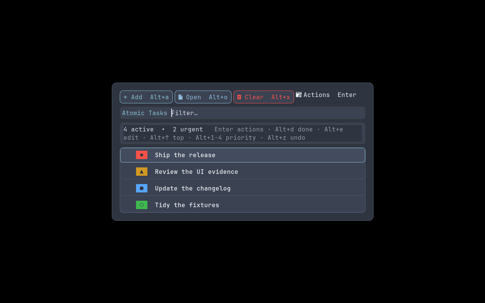
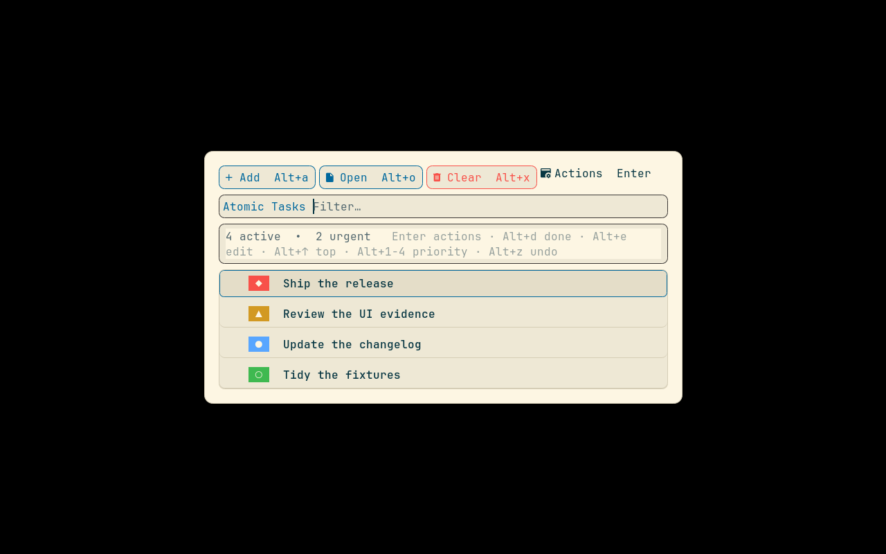

# UI screenshot matrix

Real Rofi captures of the seven native apps in four theme modes, generated
headlessly with Xvfb, Rofi 2.x, and JetBrainsMono Nerd Font.

The `*-current.png` snapshots use disposable fixtures. Real SSIDs, IP
addresses, clipboard contents, task text, command output, hostnames, and user
paths are replaced with example data; the committed `fixtures/` files, a
temporary Screen Time database, and sample menu providers are the source of
every capture.

The README shows the Gruvbox row. Every app also has `nord`, `solarized`, and
`auto` captures in this directory. The four-mode matrix is the palette/layout
baseline; the `*-current.png` files and the §18 interaction captures below are
the current controls after the UI-01..08 fixes.

| App | Gruvbox Dark | Nord | Solarized Light | Auto |
|---|---|---|---|---|
| Menu | [](hub-gruvbox.png) | [](hub-nord.png) | [](hub-solarized.png) | [](hub-auto.png) |
| Screen Time | [](screen-time-gruvbox.png) | [](screen-time-nord.png) | [](screen-time-solarized.png) | [](screen-time-auto.png) |
| Calendar | [](calendar-gruvbox.png) | [](calendar-nord.png) | [](calendar-solarized.png) | [](calendar-auto.png) |
| Clipboard | [](clipboard-gruvbox.png) | [](clipboard-nord.png) | [](clipboard-solarized.png) | [](clipboard-auto.png) |
| Keybinds | [](keybinds-gruvbox.png) | [](keybinds-nord.png) | [](keybinds-solarized.png) | [](keybinds-auto.png) |
| Network | [](network-gruvbox.png) | [](network-nord.png) | [](network-solarized.png) | [](network-auto.png) |
| Atomic Tasks | [](atomic-gruvbox.png) | [](atomic-nord.png) | [](atomic-solarized.png) | [](atomic-auto.png) |

The `auto` column falls back to Gruvbox when no matugen palette or
`static.env` is present. See [UI style](../../UI_STYLE.md) for the palette,
component grammar, and `ChromeProfile` table.

## Calendar and Network redesign

The §17 redesign captures are in [`redesign/`](redesign/). Each pair keeps the
pre-redesign image from the previous commit and the real Rofi capture after the
change, at 1280×800 with the same font and themes:

| App | Before | After |
|---|---|---|
| Calendar | [Gruvbox](redesign/calendar-before-gruvbox.png) | [Gruvbox](redesign/calendar-after-gruvbox.png), [Nord](redesign/calendar-after-nord.png), [Solarized Light](redesign/calendar-after-solarized.png), [Auto](redesign/calendar-after-auto.png) |
| Network | [Gruvbox](redesign/network-before-gruvbox.png) | [Gruvbox](redesign/network-after-gruvbox.png), [Nord](redesign/network-after-nord.png), [Solarized Light](redesign/network-after-solarized.png), [Auto](redesign/network-after-auto.png) |

Interaction states:

- Calendar date entry: [focused date](redesign/calendar-focus-gruvbox.png),
  [invalid date](redesign/calendar-invalid.png).
- Calendar narrow window: [1024×700](redesign/calendar-narrow.png).
- Network Manage: [Gruvbox](redesign/network-manage-gruvbox.png),
  [Nord](redesign/network-manage-nord.png),
  [Solarized Light](redesign/network-manage-solarized.png).
- Network Connection details:
  [Gruvbox](redesign/network-details-gruvbox.png),
  [Nord](redesign/network-details-nord.png),
  [Solarized Light](redesign/network-details-solarized.png).
- Network narrow window: [1024×700](redesign/network-narrow.png).
- Network empty state: [only active network](redesign/network-only-active.png),
  [Wi-Fi off + Ethernet](redesign/network-wifi-off.png).
- Long SSID truncation: [1024×700](redesign/network-long-ssid.png).
- Full-name filter still matches the truncated SSID:
  [filtered list](redesign/network-filter-long.png).

## Menu grids

- [App launcher 3×10](hub-launcher-3x10.png)
- [Emoji picker 4×15](hub-emoji-4x15.png)
- [Power menu 3×2](hub-power-3col.png)

## §18 UI evidence (2026-11-27)

These captures use the current binaries and disposable fixtures. They record
the interaction cases from [goal.md](../../../goal.md).

| ID | Capture | Verified behavior |
|---|---|---|
| UI-01 | [Keybinds search](redesign/ui01-keybinds-search.png) | Typing `Terminal` matches `Super+Enter`; the fixture executable runs once. |
| UI-02 | [Keybinds light selection](redesign/ui02-keybinds-light-selection.png), [Clipboard light selection](redesign/ui02-clipboard-light-selection.png) | Title/metadata stay readable on a light selected band; markers keep their role. |
| UI-03 | [Keybinds header](redesign/ui03-keybinds-header.png) | Clicking or entering a section header keeps its band unchanged and runs nothing. |
| UI-04 | [Clipboard buttons](redesign/ui04-clipboard-actions.png), [Clear confirmation](redesign/ui04-clipboard-clear-confirm.png), [Refresh with empty filter](redesign/ui04-clipboard-refresh-empty.png) | Copy/Delete act on the selected row; Clear confirms; Cancel preserves every item; Refresh works with no matches. |
| UI-05 | [Hub filter after Nord](redesign/ui05-hub-filter-nord.png), [Ctrl+4 restored](redesign/ui05-hub-auto-restored.png) | Filter, selected provider, and 1024×353 size survive all four keys; Enter launches the second provider. |
| UI-06 | [Screen Time cursor after Nord](redesign/ui06-screen-time-cursor-nord.png), [page 2 after Solarized](redesign/ui06-screen-time-page2-solarized.png), [detail after Nord](redesign/ui06-screen-time-detail-nord.png) | Third-row and page-2 selections, date/page, detail, and 1024×523/733 size survive theme changes. |
| UI-07 | [Atomic inline actions](redesign/ui07-atomic-actions.png), [Atomic Nord palette](redesign/ui07-atomic-theme-nord.png) | Enter or Actions expands Done/Edit/Move/priorities on the same list; filter and selection survive; `Ctrl+1` recolors and persists in the app-owned theme lock. |
| UI-08 | [Calendar RASI buttons](redesign/ui08-calendar-buttons.png), [typed date after Nord](redesign/ui08-calendar-typed-nord.png), [December→January](redesign/ui08-calendar-january.png) | Prev/Today/Next stay visible while typing and after a theme change; Enter resolves one date query. |
| Network regression | [Filter and Nord](redesign/network-regression-filter-nord.png), [details after Nord](redesign/network-regression-details-nord.png) | Two SSIDs stay filtered, the second is selected, size stays 804×332/624, and Enter sends one connect request. |

The fixture set is in [`fixtures/`](fixtures): `hyprland.conf`, `cliphist`,
`wl-copy`, and `nmcli`. Screen Time evidence uses a temporary SQLite fixture
with eight apps; Atomic Tasks uses a disposable HOME and task file.

## UI-09 shared style consistency (2026-11-27)

These captures use the installed launchers, the desktop base theme
(FiraCode Nerd Font 10 at 144 DPI), and disposable fixture data on a
2048×1280 Xvfb display (the desktop's 3072×1920 panel at scale 1.5). They
verify the shared selected-row and toolbar styles after a base theme or palette
change.

| App | Captures | Checked |
|---|---|---|
| Clipboard | [Auto](redesign/ui09-clipboard-auto.png) · [Nord](redesign/ui09-clipboard-nord.png) · [Solarized](redesign/ui09-clipboard-solarized.png) | Selected rows use a `surface_alt` fill with an accent outline and keep the row foreground. Copy/Delete/Clear/Refresh retain 8px button outlines. `Ctrl+4` restored the Auto capture. |
| Keybinds | [Auto](redesign/ui09-keybinds-auto.png) · [Nord](redesign/ui09-keybinds-nord.png) · [Header click](redesign/ui09-keybinds-header-click.png) | Selected rows no longer use a solid accent fill. Clicking `BASIC` leaves the header band identical and runs nothing. |
| Network | [Auto](redesign/ui09-network-auto.png) · [Nord](redesign/ui09-network-nord.png) · [Scan click](redesign/ui09-network-scan-click.png) | Selected rows and the section band follow the shared style. The Scan button works with the mouse and reports the scan in the status line. |
| Atomic Tasks | [Auto](redesign/ui09-atomic-auto.png) · [Nord](redesign/ui09-atomic-nord.png) · [Actions click](redesign/ui09-atomic-actions-click.png) | Task rows use the shared surface selection. The Actions control has a visible outline, fits on one line, and expands Done/Edit/Move/priorities when clicked. |
| Hub Menu | [Auto](redesign/ui09-hub-auto.png) · [Nord](redesign/ui09-hub-nord.png) | Provider rows use the same selected-row treatment. |
| Calendar | [Auto](redesign/ui09-calendar-auto.png) · [Focus after Nord](redesign/ui09-calendar-focus-nord.png) · [Prev click](redesign/ui09-calendar-prev-click.png) | The theme hint and the focused-date note are fully visible at the scaled font. Prev works by mouse; Today/Next were also checked. |
| Screen Time | [Auto](redesign/ui09-screen-time-auto.png) · [Nord](redesign/ui09-screen-time-nord.png) | Selected app rows keep their surface fill and accent outline across the theme switch. |

The shared Style checks were run with `cargo test --workspace --locked`,
`crates/atomic-note/tests/menu.sh`, `scripts/test-apps.sh`,
`scripts/test-theme.sh`, and `scripts/test-bundle.sh`. The theme script needs
an empty `XDG_DATA_DIRS` in this installation because the NixOS system profile
also ships `rofi/calendar.rasi`; otherwise its packaged-fallback checks pick
up the system copy before the temporary fixtures.

## UI-10 acceptance pass (2026-11-27)

The evaluated build is the working tree packaged by `scripts/package-release.sh`
into `/tmp/opencode/dist` and installed with `install.sh` into a disposable
prefix. The launchers exercised were
`/tmp/opencode/verify/home/.local/bin/{atomic-note,rofi-calendar,rofi-clipboard,rofi-hub-menu,rofi-keybinds,rofi-network,rofi-screen-time}`.
The system launchers in `/run/current-system/sw/bin` still resolve to the
older Nix-store build and were **not** used for these captures. Rofi 2.0.0 ran
under Xvfb at the baseline
1920×1080/96 DPI and the desktop logical size 2048×1280/144 DPI (the 3072×1920
panel at scale 1.5). Both runs used the desktop green palette, FiraCode Nerd
Font 10, and a disposable `HOME`/XDG tree with no app override or theme lock.
Fixtures are [`hyprland.conf`](fixtures/hyprland.conf), `cliphist`, `wl-copy`,
and `nmcli` from `fixtures/`; Screen Time used temporary SQLite databases.

| App | Baseline 1920×1080 | Desktop 2048×1280 | Secondary evidence |
|---|---|---|---|
| Atomic Tasks | [Auto](redesign/ui10-baseline-atomic.png) | [Auto](redesign/ui10-desktop-atomic.png) | [Filtered](redesign/ui10-atomic-filtered.png), [Actions by Enter](redesign/ui10-atomic-actions-enter.png), [Actions by click](redesign/ui10-atomic-actions-click.png), [640×480 filtered](redesign/ui10-atomic-640-filtered.png), [640×480 Actions](redesign/ui10-atomic-640-actions-click.png), [Nord](redesign/ui10-atomic-nord.png) |
| Screen Time | [Auto](redesign/ui10-baseline-screen-time.png) | [Auto](redesign/ui10-desktop-screen-time.png) | [Peak](redesign/ui10-screen-time-peak.png), [Empty](redesign/ui10-screen-time-empty.png), [Detail](redesign/ui10-screen-time-detail.png), [Detail after Nord](redesign/ui10-screen-time-nord.png) |
| Keybinds | [Auto](redesign/ui10-baseline-keybinds.png) | [Auto](redesign/ui10-desktop-keybinds.png) | [Description filter](redesign/ui10-keybinds-description.png), [Shortcut filter](redesign/ui10-keybinds-shortcut.png), [Nord](redesign/ui10-keybinds-nord.png) |
| Hub Menu | [Auto](redesign/ui10-baseline-hub.png) | [Auto](redesign/ui10-desktop-hub.png) | [One result](redesign/ui10-hub-one.png), [Zero results](redesign/ui10-hub-zero.png), [Nord](redesign/ui10-hub-nord.png), [Auto restored](redesign/ui10-hub-auto.png) |
| Clipboard | [Auto](redesign/ui10-baseline-clipboard.png) | [Auto](redesign/ui10-desktop-clipboard.png) | [Initial first entry](redesign/ui10-clipboard-initial.png), [live 3 matches](redesign/ui10-clipboard-matches.png), [live 0 matches](redesign/ui10-clipboard-zero.png), [3 matches at 144 DPI](redesign/ui10-clipboard-matches-desktop.png), [0 matches at 144 DPI](redesign/ui10-clipboard-zero-desktop.png), [Nord](redesign/ui10-clipboard-nord.png) |
| Network | [Auto](redesign/ui10-baseline-network.png) | [Auto](redesign/ui10-desktop-network.png) | [Details by click](redesign/ui10-network-details.png), [Closed by Alt+i](redesign/ui10-network-details-closed.png), [Details after Nord](redesign/ui10-network-nord.png) |
| Calendar | [Auto](redesign/ui10-baseline-calendar.png) | [Auto](redesign/ui10-desktop-calendar.png) | [Four weeks](redesign/ui10-calendar-4weeks.png), [Six weeks](redesign/ui10-calendar-6weeks.png), [Button clicks 96 DPI](redesign/ui10-calendar-buttons-desk.png), [button clicks 144 DPI](redesign/ui10-calendar-buttons-desktop.png), [coordinate log](redesign/ui10-calendar-buttons.txt), [Typed date](redesign/ui10-calendar-typed.png), [partial date after Ctrl+2](redesign/ui10-calendar-partial.png), [applied date after Ctrl+3](redesign/ui10-calendar-applied-ctrl3.png), [Nord](redesign/ui10-calendar-nord.png) |

Ctrl+2 (Solarized) and Ctrl+3 (Gruvbox) were exercised in the same process at
both scales. Every app kept its typed input or filter, selection, and any
expanded state; the window size and position were identical before and after
each switch. Raw values are in
[`ui10-ctrl23.txt`](redesign/ui10-ctrl23.txt).

| App | 1920×1080/96 DPI | 2048×1280/144 DPI | State held through both switches |
|---|---|---|---|
| Atomic Tasks | [Ctrl+2](redesign/ui10-ctrl2-atomic-note-desk.png) · [Ctrl+3](redesign/ui10-ctrl3-atomic-note-desk.png) | [Ctrl+2](redesign/ui10-ctrl2-atomic-note-desktop.png) · [Ctrl+3](redesign/ui10-ctrl3-atomic-note-desktop.png) | `Review` filter, expanded Done/Edit/Top and priority rows, selected task; `1070×282` / `1139×282`. |
| Screen Time | [Ctrl+2](redesign/ui10-ctrl2-screen-time-desk.png) · [Ctrl+3](redesign/ui10-ctrl3-screen-time-desk.png) | [Ctrl+2](redesign/ui10-ctrl2-screen-time-desktop.png) · [Ctrl+3](redesign/ui10-ctrl3-screen-time-desktop.png) | Third app row selected, Terminal detail panel open; `1504×741` at both scales. |
| Keybinds | [Ctrl+2](redesign/ui10-ctrl2-keybinds-desk.png) · [Ctrl+3](redesign/ui10-ctrl3-keybinds-desk.png) | [Ctrl+2](redesign/ui10-ctrl2-keybinds-desktop.png) · [Ctrl+3](redesign/ui10-ctrl3-keybinds-desktop.png) | `Terminal` filter, `BASIC` header, selected `Super+Enter` row; Enter ran `foot`; `944×280` at both scales. |
| Hub Menu | [Ctrl+2](redesign/ui10-ctrl2-hub-desk.png) · [Ctrl+3](redesign/ui10-ctrl3-hub-desk.png) | [Ctrl+2](redesign/ui10-ctrl2-hub-desktop.png) · [Ctrl+3](redesign/ui10-ctrl3-hub-desktop.png) | `Clipboard` filter, `Clipboard History` selected; `832×577` at both scales. |
| Clipboard | [Ctrl+2](redesign/ui10-ctrl2-clipboard-desk.png) · [Ctrl+3](redesign/ui10-ctrl3-clipboard-desk.png) | [Ctrl+2](redesign/ui10-ctrl2-clipboard-desktop.png) · [Ctrl+3](redesign/ui10-ctrl3-clipboard-desktop.png) | `Example` filter, link row selected; Enter copied `2	https://example.com/docs/rofi-hub/themes`; `704×415` at both scales. |
| Network | [Ctrl+2](redesign/ui10-ctrl2-network-desk.png) · [Ctrl+3](redesign/ui10-ctrl3-network-desk.png) | [Ctrl+2](redesign/ui10-ctrl2-network-desktop.png) · [Ctrl+3](redesign/ui10-ctrl3-network-desktop.png) | Details panel open, `Studio 5G` selected; `656×642` at both scales. |
| Calendar | [Ctrl+2](redesign/ui10-ctrl2-calendar-desk.png) · [Ctrl+3](redesign/ui10-ctrl3-calendar-desk.png) | [Ctrl+2](redesign/ui10-ctrl2-calendar-desktop.png) · [Ctrl+3](redesign/ui10-ctrl3-calendar-desktop.png) | Applied `15/03/2027` then month-next to April 2027; `406×435` at both scales. Partial `15/03` and the applied March focus also survived in [the focused checks](redesign/ui10-calendar-partial.png). |

Checks from this pass:

- **Atomic Tasks.** The fixed filter and status stay above the expandable
  Done/Edit/Top and priority rows. Enter and a mouse click on Actions expanded
  the same inline controls; the filter (`Review`) and the selected task stayed
  visible. The 640×480 window renders all four toolbar buttons and both action
  rows without clipping. Open/Done/Edit/Top share the neutral outline; Add is
  the accent, Clear the danger role, and priorities keep their four semantic
  colors. `crates/atomic-note/tests/menu.sh`: 38/0.
- **Screen Time.** Auto resolves the desktop palette rather than static.env or
  Gruvbox: the generated theme contains `#9fd49c` accent, `#272b26` selection,
  and `#424940` border, with zero `#fabd2f` occurrences. Peak appears once in
  the DAY ACTIVITY header; the zero-activity screen reads “No activity
  recorded”. Category colors and timeline geometry are unchanged. The third
  app row and expanded detail survive Nord and Ctrl+4.
- **Keybinds.** The 48-bind fixture folds to 42 displayed bindings across three
  columns, including long descriptions. Typing `Terminal` keeps the `BASIC`
  header and selects `Super+Enter`; typing `Super+Enter` selects the same row.
  Enter ran the fixture `foot` once for each filter (two log entries). The hint
  stays in the fixed message while filtering.
- **Hub Menu.** Navigation and launch hints remain fixed with the full list,
  `Atomic` (one result), `Clipboard` (selected provider), and `zzzz` (zero
  results). Geometry stayed `832×577` before and after Nord; the filter and
  selected provider survived Ctrl+1 and Ctrl+4.
- **Clipboard.** The fixed header shows `8 items` once. The match count is
  Rofi’s live `num-filtered-rows` widget, not text computed at launch: typing
  `Example` changed it to `matching 3` and `zzzz` to `matching 0` without
  `Alt+r`. The `HISTORY` band is fixed chrome rather than a list row, so the
  first history entry is selected on open. With `Example` typed and the link
  row selected, Enter copied `2	https://example.com/docs/rofi-hub/themes` at
  both scales after Ctrl+2 and Ctrl+3 (fixture `wl-copy` log).
- **Network.** The twelve-candidate fixture lists all twelve in the main view.
  With details open the list still shows eight networks (previously four), and
  IP/prefix, gateway, VPN, DNS, interface/band/security, subnet/broadcast, and
  MAC each appear once. The Details button and `Alt+i` open and close the same
  inline panel.
- **Calendar.** Four-, five-, and six-week months all measured `406×435` at
  both scales. The Prev/Today/Next centres were `(40,349)`, `(203,349)`, and
  `(366,349)` relative to the window in every month. Clicking those exact
  coordinates changed Feb 2027→Jan 2027→Feb 2027→Feb 2027, Nov 2026→Oct
  2026→Nov 2026→Nov 2026, and Aug 2026→Jul 2026→Aug 2026→Aug 2026
  ([96 DPI](redesign/ui10-calendar-buttons-desk.png),
  [144 DPI](redesign/ui10-calendar-buttons-desktop.png), each sheet ordered
  before/Prev/Next/Today, and the
  [coordinates](redesign/ui10-calendar-buttons.txt)). The month grid, date
  field, and theme hint fit. Typed `15/03/2027` selected the date, Right/Left
  moved to April/March, and Ctrl+t returned to today. A partial `15/03` field
  and the applied March 15 focus survived Ctrl+2 and Ctrl+3; the date-note
  window stayed `406×452` across those switches.
- **Theme state.** Ctrl+1 (Nord), Ctrl+2 (Solarized), Ctrl+3 (Gruvbox), and
  Ctrl+4 (Auto) preserve typed input, selection, filters, expanded details,
  and geometry in Atomic Tasks, Clipboard, Keybinds, Network, Calendar, Hub
  Menu, and Screen Time. Ctrl+4 restores the configured green palette in the
  checked apps. The Ctrl+2/Ctrl+3 pass at both scales is tabulated above.
- **Headers.** Moving the pointer over the Keybinds `BASIC` band left the band
  pixel-identical; clicking and pressing Enter on Keybinds `BASIC`, Clipboard
  `HISTORY`, and Hub `PRODUCTIVITY` also left the bands unchanged and ran no
  provider, copy, or shortcut action. [Hover](redesign/ui10-keybinds-header-hover.png) ·
  [Keybinds click](redesign/ui10-keybinds-header.png) ·
  [Keybinds Enter](redesign/ui10-keybinds-header-enter.png) ·
  [Clipboard](redesign/ui10-clipboard-header.png) · [Hub](redesign/ui10-hub-header.png).
- **Existing checks.** `cargo test --workspace --locked` (all groups),
  `cargo clippy --workspace --all-targets --locked -- -D warnings`,
  `crates/atomic-note/tests/menu.sh` (38/0), `scripts/test-apps.sh` (31/0),
  `scripts/test-theme.sh` (14/0), `scripts/test-bundle.sh` (35/0),
  `scripts/check-app-sync.py` (76 checks), and `scripts/check-deps.py`
  (121 checks) passed against the rebuilt package. `git diff --check` is
  clean.

Re-scored on the four review criteria within the checked scope. The previous
pass had three evidence gaps — live Clipboard counts, Ctrl+2/Ctrl+3
preservation, and Calendar button coordinates — and each is now covered by the
captures and raw logs above. The scores below therefore reflect verified
behavior in this environment; they do not claim the live-session items listed
after the table.

| App | Consistency | Readability | Primary task | Interaction | Total |
|---|---:|---:|---:|---:|---:|
| Atomic Tasks | 2 | 2 | 2 | 2 | 8/8 |
| Screen Time | 2 | 2 | 2 | 2 | 8/8 |
| Keybinds | 2 | 2 | 2 | 2 | 8/8 |
| Hub Menu | 2 | 2 | 2 | 2 | 8/8 |
| Clipboard | 2 | 2 | 2 | 2 | 8/8 |
| Network | 2 | 2 | 2 | 2 | 8/8 |
| Calendar | 2 | 2 | 2 | 2 | 8/8 |

Remaining unverified: a live Wayland/Hyprland session, the installed Nix
package reached by the desktop shortcut, real NetworkManager/clipboard data,
and physical HiDPI output. All captures use Xvfb, the rebuilt temporary
package, and fixture backends. No app-specific override or theme lock was
present for the baseline comparison.

## Regenerating

The captures use the real app binaries through Rofi dmenu, not mockups. The
generation environment needs an X11-capable Rofi, `Xvfb`, and ImageMagick:

```bash
cargo build --release --locked --workspace

# Install the app payloads into a throwaway prefix.
DIST=$(mktemp -d)
DIST="$DIST" scripts/package-release.sh
scripts/test-bundle.sh "$DIST"   # verifies install.sh before capture
HOME=/tmp/ui-home PREFIX=/tmp/ui-stage \
  bash install.sh --index "$DIST/index.json" --allow-unsigned --all

Xvfb :99 -screen 0 1280x800x24 &
env -u WAYLAND_DISPLAY -u HYPRLAND_INSTANCE_SIGNATURE -u XDG_SESSION_TYPE \
  DISPLAY=:99 HOME=/tmp/ui-home XDG_CONFIG_HOME=/tmp/ui-config \
  XDG_DATA_HOME=/tmp/ui-data XDG_RUNTIME_DIR=/tmp/ui-run \
  PATH="/tmp/ui-stage/bin:$PATH" \
  rofi-calendar &
DISPLAY=:99 import -window root docs/screenshots/ui/calendar-gruvbox.png
```

Use the app binary directly (`rofi-calendar`, `rofi-clipboard`,
`rofi-keybinds`, `rofi-network`, `atomic-note`, `rofi-screen-time`) or the optional menu
(`rofi-hub-menu`). Theme selection uses the user base theme
`~/.config/rofi/theme.rasi`, an app override `~/.config/rofi/<app>.rasi`,
`ROFI_THEME`, or the menu's own `rofi-hub-menu theme set` state. Apps do not
read `ROFI_HUB_THEME`.

The redesign captures use `xdotool` for the date-entry, Manage, and details
states, and set a full `ROFI_THEME` (from
`cargo run -p rofi-dmenu --example dump-theme -- <app> <mode>`) plus
`~/.config/theme/static.env` for the Nord/Solarized markup palette. Auto uses
the built-in Gruvbox fallback. `scripts/test-performance.sh` measures the same
binaries with the fake runtime tools.

The committed `fixtures/` directory contains the fake `cliphist`, `wl-copy`,
and `nmcli` scripts plus a small `hyprland.conf` for deterministic captures.
Network captures use `fixtures/nmcli`: example SSIDs, TEST-NET-1 IPv4
(`192.0.2.0/24`), and the locally administered MAC
`02:00:00:00:00:01`.
