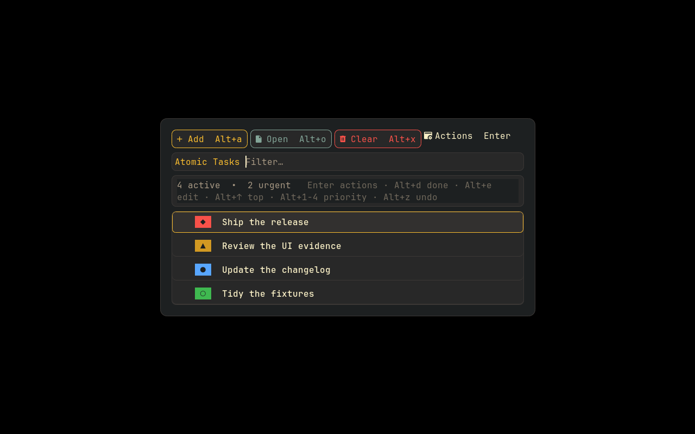
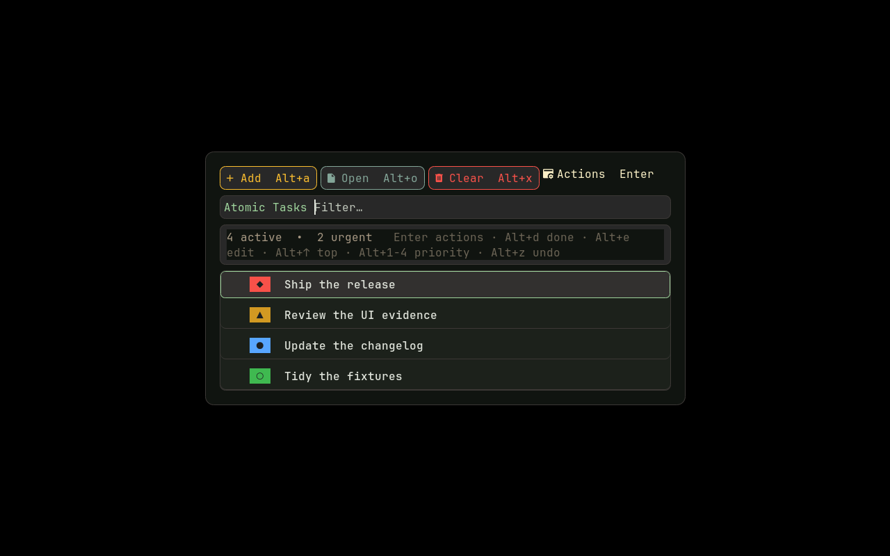

# UI screenshot matrix

Real Rofi captures of the seven native apps in four theme modes, generated
headlessly with Xvfb, Rofi 2.x, and JetBrainsMono Nerd Font.

The `*-current.png` snapshots use disposable fixtures. Real SSIDs, IP
addresses, clipboard contents, task text, command output, hostnames, and user
paths are replaced with example data; the committed `fixtures/` files, a
temporary Screen Time database, and sample menu providers are the source of
every capture.

The README shows the Gruvbox row. Every app also has `nord`, `solarized`, and
`auto` captures in this directory. The four-mode matrix is the palette/layout
baseline; the `*-current.png` files and the §18 interaction captures below are
the current controls after the UI-01..08 fixes.

| App | Gruvbox Dark | Nord | Solarized Light | Auto |
|---|---|---|---|---|
| Menu | [](hub-gruvbox.png) | [](hub-nord.png) | [](hub-solarized.png) | [](hub-auto.png) |
| Screen Time | [](screen-time-gruvbox.png) | [](screen-time-nord.png) | [](screen-time-solarized.png) | [](screen-time-auto.png) |
| Calendar | [](calendar-gruvbox.png) | [](calendar-nord.png) | [](calendar-solarized.png) | [](calendar-auto.png) |
| Clipboard | [](clipboard-gruvbox.png) | [](clipboard-nord.png) | [](clipboard-solarized.png) | [](clipboard-auto.png) |
| Keybinds | [](keybinds-gruvbox.png) | [](keybinds-nord.png) | [](keybinds-solarized.png) | [](keybinds-auto.png) |
| Network | [](network-gruvbox.png) | [](network-nord.png) | [](network-solarized.png) | [](network-auto.png) |
| Atomic Tasks | [](atomic-gruvbox.png) | [](atomic-nord.png) | [](atomic-solarized.png) | [](atomic-auto.png) |

The `auto` column falls back to Gruvbox when no matugen palette or
`static.env` is present. See [UI style](../../UI_STYLE.md) for the palette,
component grammar, and `ChromeProfile` table.

## Calendar and Network redesign

The §17 redesign captures are in [`redesign/`](redesign/). Each pair keeps the
pre-redesign image from the previous commit and the real Rofi capture after the
change, at 1280×800 with the same font and themes:

| App | Before | After |
|---|---|---|
| Calendar | [Gruvbox](redesign/calendar-before-gruvbox.png) | [Gruvbox](redesign/calendar-after-gruvbox.png), [Nord](redesign/calendar-after-nord.png), [Solarized Light](redesign/calendar-after-solarized.png), [Auto](redesign/calendar-after-auto.png) |
| Network | [Gruvbox](redesign/network-before-gruvbox.png) | [Gruvbox](redesign/network-after-gruvbox.png), [Nord](redesign/network-after-nord.png), [Solarized Light](redesign/network-after-solarized.png), [Auto](redesign/network-after-auto.png) |

Interaction states:

- Calendar date entry: [focused date](redesign/calendar-focus-gruvbox.png),
  [invalid date](redesign/calendar-invalid.png).
- Calendar narrow window: [1024×700](redesign/calendar-narrow.png).
- Network Manage: [Gruvbox](redesign/network-manage-gruvbox.png),
  [Nord](redesign/network-manage-nord.png),
  [Solarized Light](redesign/network-manage-solarized.png).
- Network Connection details:
  [Gruvbox](redesign/network-details-gruvbox.png),
  [Nord](redesign/network-details-nord.png),
  [Solarized Light](redesign/network-details-solarized.png).
- Network narrow window: [1024×700](redesign/network-narrow.png).
- Network empty state: [only active network](redesign/network-only-active.png),
  [Wi-Fi off + Ethernet](redesign/network-wifi-off.png).
- Long SSID truncation: [1024×700](redesign/network-long-ssid.png).
- Full-name filter still matches the truncated SSID:
  [filtered list](redesign/network-filter-long.png).

## Menu grids

- [App launcher 3×10](hub-launcher-3x10.png)
- [Emoji picker 4×15](hub-emoji-4x15.png)
- [Power menu 3×2](hub-power-3col.png)

## §18 UI evidence (2026-11-27)

These captures use the current binaries and disposable fixtures. They record
the interaction cases from [goal.md](../../../goal.md).

| ID | Capture | Verified behavior |
|---|---|---|
| UI-01 | [Keybinds search](redesign/ui01-keybinds-search.png) | Typing `Terminal` matches `Super+Enter`; the fixture executable runs once. |
| UI-02 | [Keybinds light selection](redesign/ui02-keybinds-light-selection.png), [Clipboard light selection](redesign/ui02-clipboard-light-selection.png) | Title/metadata stay readable on a light selected band; markers keep their role. |
| UI-03 | [Keybinds header](redesign/ui03-keybinds-header.png) | Clicking or entering a section header keeps its band unchanged and runs nothing. |
| UI-04 | [Clipboard buttons](redesign/ui04-clipboard-actions.png), [Clear confirmation](redesign/ui04-clipboard-clear-confirm.png), [Refresh with empty filter](redesign/ui04-clipboard-refresh-empty.png) | Copy/Delete act on the selected row; Clear confirms; Cancel preserves every item; Refresh works with no matches. |
| UI-05 | [Hub filter after Nord](redesign/ui05-hub-filter-nord.png), [Ctrl+4 restored](redesign/ui05-hub-auto-restored.png) | Filter, selected provider, and 1024×353 size survive all four keys; Enter launches the second provider. |
| UI-06 | [Screen Time cursor after Nord](redesign/ui06-screen-time-cursor-nord.png), [page 2 after Solarized](redesign/ui06-screen-time-page2-solarized.png), [detail after Nord](redesign/ui06-screen-time-detail-nord.png) | Third-row and page-2 selections, date/page, detail, and 1024×523/733 size survive theme changes. |
| UI-07 | [Atomic inline actions](redesign/ui07-atomic-actions.png), [Atomic Nord palette](redesign/ui07-atomic-theme-nord.png) | Enter or Actions expands Done/Edit/Move/priorities on the same list; filter and selection survive; `Ctrl+1` recolors and persists in the app-owned theme lock. |
| UI-08 | [Calendar RASI buttons](redesign/ui08-calendar-buttons.png), [typed date after Nord](redesign/ui08-calendar-typed-nord.png), [December→January](redesign/ui08-calendar-january.png) | Prev/Today/Next stay visible while typing and after a theme change; Enter resolves one date query. |
| Network regression | [Filter and Nord](redesign/network-regression-filter-nord.png), [details after Nord](redesign/network-regression-details-nord.png) | Two SSIDs stay filtered, the second is selected, size stays 804×332/624, and Enter sends one connect request. |

The fixture set is in [`fixtures/`](fixtures): `hyprland.conf`, `cliphist`,
`wl-copy`, and `nmcli`. Screen Time evidence uses a temporary SQLite fixture
with eight apps; Atomic Tasks uses a disposable HOME and task file.

## Regenerating

The captures use the real app binaries through Rofi dmenu, not mockups. The
generation environment needs an X11-capable Rofi, `Xvfb`, and ImageMagick:

```bash
cargo build --release --locked --workspace

# Install the app payloads into a throwaway prefix.
DIST=$(mktemp -d)
DIST="$DIST" scripts/package-release.sh
scripts/test-bundle.sh "$DIST"   # verifies install.sh before capture
HOME=/tmp/ui-home PREFIX=/tmp/ui-stage \
  bash install.sh --index "$DIST/index.json" --allow-unsigned --all

Xvfb :99 -screen 0 1280x800x24 &
env -u WAYLAND_DISPLAY -u HYPRLAND_INSTANCE_SIGNATURE -u XDG_SESSION_TYPE \
  DISPLAY=:99 HOME=/tmp/ui-home XDG_CONFIG_HOME=/tmp/ui-config \
  XDG_DATA_HOME=/tmp/ui-data XDG_RUNTIME_DIR=/tmp/ui-run \
  PATH="/tmp/ui-stage/bin:$PATH" \
  rofi-calendar &
DISPLAY=:99 import -window root docs/screenshots/ui/calendar-gruvbox.png
```

Use the app binary directly (`rofi-calendar`, `rofi-clipboard`,
`rofi-keybinds`, `rofi-network`, `atomic-note`, `rofi-screen-time`) or the optional menu
(`rofi-hub-menu`). Theme selection uses the user base theme
`~/.config/rofi/theme.rasi`, an app override `~/.config/rofi/<app>.rasi`,
`ROFI_THEME`, or the menu's own `rofi-hub-menu theme set` state. Apps do not
read `ROFI_HUB_THEME`.

The redesign captures use `xdotool` for the date-entry, Manage, and details
states, and set a full `ROFI_THEME` (from
`cargo run -p rofi-dmenu --example dump-theme -- <app> <mode>`) plus
`~/.config/theme/static.env` for the Nord/Solarized markup palette. Auto uses
the built-in Gruvbox fallback. `scripts/test-performance.sh` measures the same
binaries with the fake runtime tools.

The committed `fixtures/` directory contains the fake `cliphist`, `wl-copy`,
and `nmcli` scripts plus a small `hyprland.conf` for deterministic captures.
Network captures use `fixtures/nmcli`: example SSIDs, TEST-NET-1 IPv4
(`192.0.2.0/24`), and the locally administered MAC
`02:00:00:00:00:01`.
